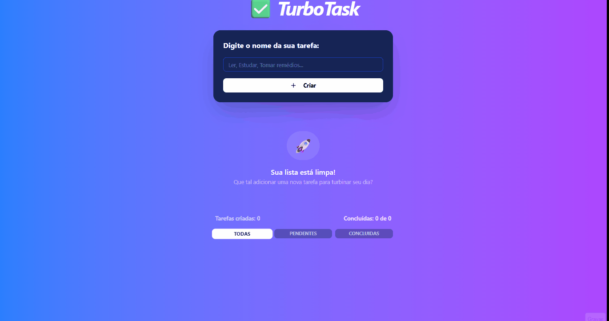
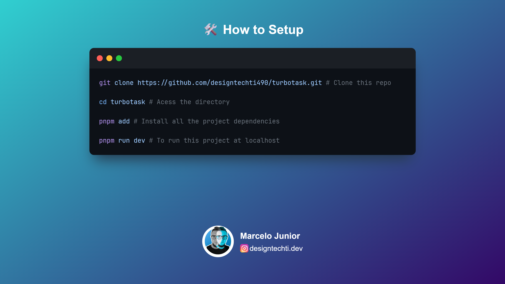

# ✅ TurboTask

TurboTask is a high-performance task manager focused on simplicity and fluidity. Developed with React, TypeScript, and Vite, it offers a modern user experience with smooth animations and data persistence.



## ✨ Features

- **Task CRUD:** Add, list, mark as completed, and delete tasks.
- **Smart Filters:** View all, only pending, or only completed tasks.
- **Per-user persistence:** Tasks and tickets are stored in Supabase and isolated by account.
- **Premium Interface:** Modern design with Glassmorphism and vibrant gradients.
- **Fluid Animations:** Smooth transitions when adding or removing items using Framer Motion.
- **Real-Time Counter:** Track your progress with dynamic statistics.

## 🛠️ Technologies

&nbsp;
&nbsp;
&nbsp;
&nbsp;

## ⚡ How to setup



## 🔐 Supabase authentication and data isolation

The app uses Supabase email/password authentication. Before running it, apply
[`supabase/migrations/20261125120000_user_owned_data.sql`](supabase/migrations/20261125120000_user_owned_data.sql)
and then
[`supabase/migrations/20261125133000_it_shared_tickets.sql`](supabase/migrations/20261125133000_it_shared_tickets.sql)
to your Supabase project (for example, in the SQL Editor).

Existing records keep a `NULL` owner and are therefore hidden from signed-in
users. Assign those records to the intended account before making them
available; do not assign them to a user unless that ownership is confirmed.

Tasks remain private to their owner. Ticket requesters can read their own
tickets and delete them while they are open; IT users can read all tickets,
change their status, and delete any ticket. The IT migration replaces the
ticket policies created by the first migration.

Assign the IT role only from a trusted admin context. For a one-time assignment
in the Supabase SQL Editor, replace the example address with the IT user's
account email:

```sql
UPDATE auth.users
SET raw_app_meta_data =
  COALESCE(raw_app_meta_data, '{}'::jsonb) || '{"role":"it"}'::jsonb
WHERE email = 'it@example.com';
```

The role is stored in protected `app_metadata`, not user-editable metadata.
The IT user must sign out and back in for the new role to appear in their
session.

## Fluxograms


